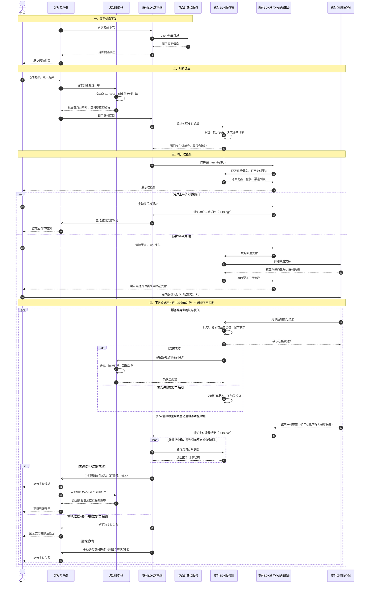

# 端内 Web 收银台支付流程 PRD

本文记录已确认的游戏内支付流程，覆盖商品信息下发、下单、端内 Web 收银台支付、服务端支付确认与发货，以及支付 SDK 客户端查单后通知游戏客户端展示结果。本文仅记录幂等相关的超时、查询和对账原则，不展开完整的异常恢复和补单流程。

## 商品信息下发

游戏客户端向支付 SDK 客户端请求商品下发。支付 SDK 客户端向商品计费点服务查询商品信息，再将查询结果返回给游戏客户端，由游戏客户端向用户展示商品信息。

## 支付结果规则

- 支付 SDK 客户端向支付 SDK 服务端查询订单状态后，主动通知游戏客户端展示支付结果；Web 收银台只通知支付流程结束，不直接提供最终支付结果。
- 用户主动关闭收银台时，支付 SDK 客户端向游戏客户端返回“支付取消”。
- 查询结果为支付成功时，返回“支付成功”；查询结果为支付失败或订单关闭时，返回“支付失败”。
- 查询超时时，向游戏客户端返回“支付失败”，原因为“查询超时”，不返回“处理中”或“待确认”。
- 支付取消和查询超时失败属于客户端回调状态，不直接改变服务端实际支付状态。服务端按渠道实际支付结果确认订单并幂等发货。
- 服务端支付确认与客户端查单并行，先后顺序不固定；支付成功与商品或资产到账可能存在时间差。

## 幂等与重复支付控制

### 目标

保证同一个游戏订单最终只成功支付一次、只发货一次；同时允许用户在同一个支付渠道下切换支付方式，例如从 PayerMax 卡支付切换为 YooMoney 钱包支付。

### 幂等层级

幂等控制分为四个层级，各层使用不同的业务标识：

| 层级 | 幂等对象 | 幂等标识 | 规则 |
| --- | --- | --- | --- |
| 订单级 | 游戏订单最终支付结果 | `order_id` | 一个订单只能从未支付变为支付成功一次；成功后不得再次发货或重复记账 |
| 支付尝试级 | 用户选定一次支付方式的尝试 | `attempt_id` | 同一次尝试的重复点击、重复提交、接口重试必须复用同一个 `attempt_id` |
| 渠道请求级 | 渠道创建支付请求 | `channel_idempotency_key` | 同一个 `attempt_id` 始终使用同一个渠道幂等号；不得因超时重新生成 |
| 回调级 | 渠道异步通知事件 | `channel_transaction_id + event_type` | 同一渠道事件重复通知时只处理一次，并向渠道返回已接收 |

### 支付尝试规则

1. 收银台首次选择支付方式时创建支付尝试，生成全局唯一的 `attempt_id`。建议渠道幂等号由商户号、游戏订单号和支付尝试号组成：

   ```text
   channel_idempotency_key = merchant_id + ":" + order_id + ":" + attempt_id
   ```

2. 前端重复点击、网络超时重试或页面重新打开时，优先恢复原支付尝试并复用原 `attempt_id`，不得无条件新建支付尝试。

3. 同一个订单下，不同支付方式是不同的支付尝试。例如：

   ```text
   order_id = O1001
     ├── A1：PayerMax 卡支付
     └── A2：YooMoney 钱包支付
   ```

   两种支付方式不得共用渠道幂等号，否则渠道可能将第二种支付方式识别为第一次请求的重复请求。

4. 用户切换支付方式时，只有在原支付尝试已确认进入 `FAILED`、`CANCELLED` 或 `EXPIRED` 后，才能创建新的支付尝试。若原尝试已经进入 `SUCCESS`，不得创建新的可支付尝试；若原尝试为 `UNKNOWN`，不能仅在本地标记取消后立即创建新尝试，必须先通过渠道查询确认原交易未成功且已不可继续，或获得渠道明确的关闭结果。

5. 同一订单同一时刻最多允许一个处于 `PAYING` 或 `UNKNOWN` 状态的活动支付尝试。数据库必须通过唯一约束或事务状态校验保证该规则，分布式锁只能作为并发优化手段，不能作为唯一保障。

### 支付尝试状态

支付尝试至少支持以下状态：

```text
INIT -> PAYING -> SUCCESS
                 ├-> FAILED
                 ├-> CANCELLED
                 ├-> EXPIRED
                 └-> UNKNOWN
```

- `INIT`：已创建支付尝试，尚未成功提交渠道请求。
- `PAYING`：已向渠道提交支付请求，等待用户完成或渠道返回结果。
- `UNKNOWN`：请求超时或连接中断，无法确认渠道是否已创建交易。
- `SUCCESS`、`FAILED`、`CANCELLED`、`EXPIRED`：终态，终态不得被普通重试覆盖。

状态更新必须使用带当前状态条件的原子更新。例如只有 `INIT`、`PAYING`、`UNKNOWN` 才允许更新为 `SUCCESS`，避免并发回调重复触发后续处理。

### 渠道请求与超时处理

- 渠道请求发出后未收到响应时，支付尝试置为 `UNKNOWN`，不得直接创建新的渠道交易。
- 如果渠道支持幂等，使用同一个 `channel_idempotency_key` 重试；如果渠道不支持幂等，必须先按商户订单号、商户请求号或渠道请求号主动查询，再决定是否重试。
- 渠道返回的支付凭据、渠道交易号和请求结果必须持久化，后续重试复用已有记录。
- 对于无法通过实时查询确认的 `UNKNOWN` 订单，由异步查询或对账任务兜底，直到进入明确终态。
- `UNKNOWN` 状态下，用户端可以按既定规则展示查询超时或支付失败，但服务端不能据此认定原交易失败，也不能并行创建另一笔可支付交易。

### 订单成功与发货幂等

收到支付成功通知时，服务端必须在同一事务或可靠消息流程内完成以下校验：

- 校验商户号、订单号、支付尝试号或渠道交易号、金额、币种和签名。
- 仅当游戏订单仍为未支付状态时，才将其更新为已支付。
- 只有首次成功更新订单状态的请求可以触发游戏服务端发货；后续重复回调、其他支付尝试的迟到成功结果不得再次发货。
- 游戏服务端按 `order_id` 或发货业务号建立唯一约束，保证发货接口重复调用也只产生一次资产到账。

### 回调去重

服务端以 `channel_transaction_id + event_type` 建立回调事件唯一记录。重复回调执行以下逻辑：

1. 校验签名和订单信息。
2. 若该事件已成功处理，直接返回渠道要求的成功响应。
3. 若事件正在处理或上次处理失败，根据事件记录重试或进入补偿队列。
4. 不因重复回调重复发货、重复记账或重复通知游戏服务端。

客户端收银台关闭、支付流程结束和查单超时，只代表客户端展示流程结束，不改变服务端支付尝试的真实状态；服务端仍以渠道回调、主动查询和对账结果为准。

## 支付时序图


