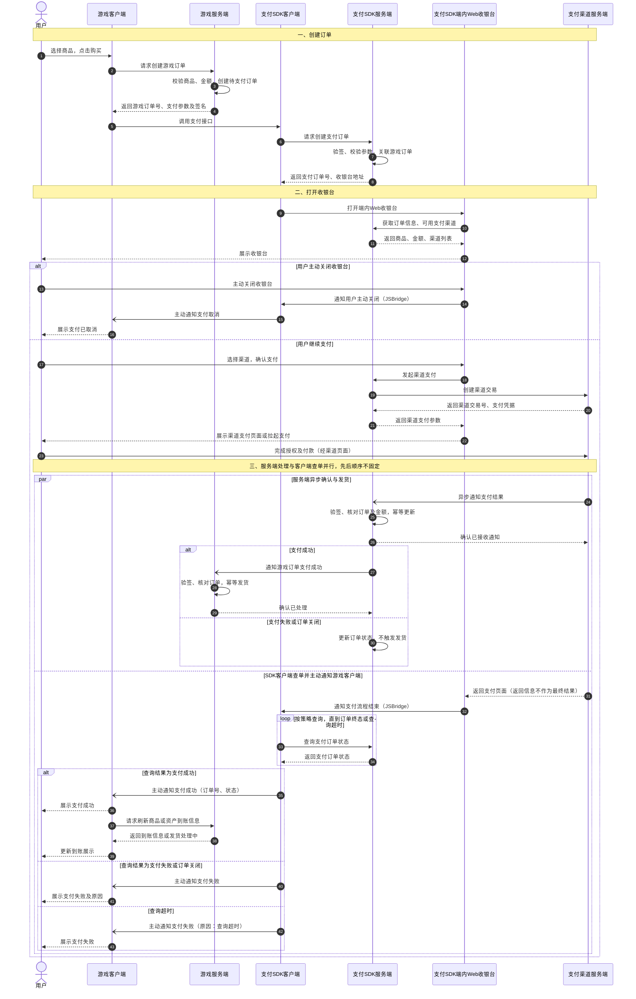

# 端内 Web 收银台支付流程 PRD

本文记录已确认的游戏内支付流程，覆盖下单、端内 Web 收银台支付、服务端支付确认与发货，以及支付 SDK 客户端查单后通知游戏客户端展示结果。不包含异常恢复和补单流程。

## 支付结果规则

- 支付 SDK 客户端向支付 SDK 服务端查询订单状态后，主动通知游戏客户端展示支付结果；Web 收银台只通知支付流程结束，不直接提供最终支付结果。
- 用户主动关闭收银台时，支付 SDK 客户端向游戏客户端返回“支付取消”。
- 查询结果为支付成功时，返回“支付成功”；查询结果为支付失败或订单关闭时，返回“支付失败”。
- 查询超时时，向游戏客户端返回“支付失败”，原因为“查询超时”，不返回“处理中”或“待确认”。
- 支付取消和查询超时失败属于客户端回调状态，不直接改变服务端实际支付状态。服务端按渠道实际支付结果确认订单并幂等发货。
- 服务端支付确认与客户端查单并行，先后顺序不固定；支付成功与商品或资产到账可能存在时间差。

## 支付时序图

